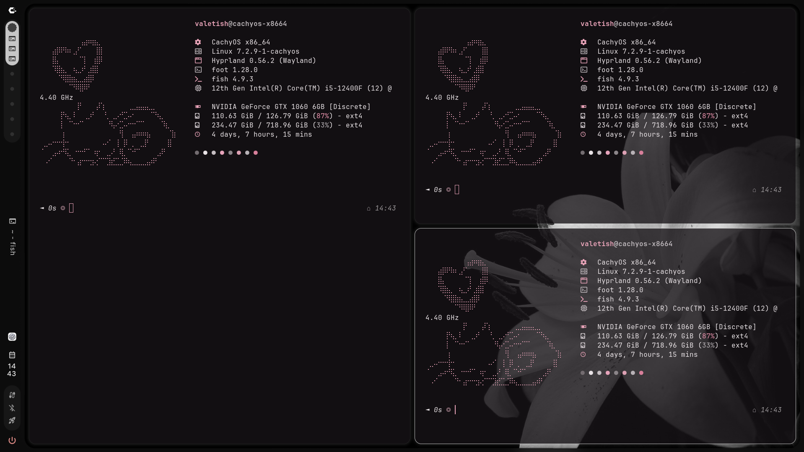
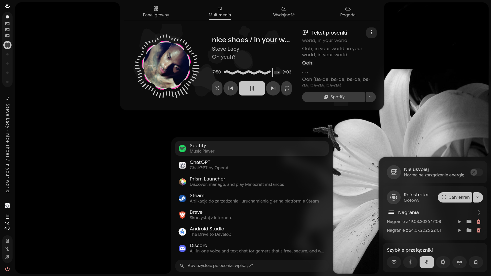

# Dotfiles

Personal configuration for Caelestia, Fish, Foot, Neovim, Starship and Fastfetch.

This repository deliberately keeps custom Caelestia configuration in
`~/.config/caelestia`. It does **not** store `~/.config/hypr`, which Caelestia
manages itself during installation and updates.

## Screenshots

Foot terminals with Fastfetch and the wallpaper visible through transparent windows:



Caelestia desktop with the dashboard, launcher and sidebar:



## New laptop (Arch Linux)

1. Install Caelestia and apply its defaults:

   ```bash
   paru -S caelestia-cli
   caelestia install
   ```

2. Clone this repository and install the personal configuration:

   ```bash
   git clone git@github.com:Valetish/dotfiles.git ~/dotfiles
   cd ~/dotfiles
   ./install.sh
   ```

`install.sh` installs the included `IMG_7745.JPEG` wallpaper into
`~/Pictures/Wallpapers` and selects it in Caelestia. It moves any existing
matching configuration into `~/.dotfiles-backup/<timestamp>` and replaces it
with symlinks to this repository. Review that backup before deleting it.

## Notes

- Install the programs referenced by the configuration: `fish`, `foot`,
  `neovim`, `starship`, `fastfetch`, `direnv`, `zoxide`, `eza`, `lazygit` and
  the JetBrains Mono Nerd Font.
- `hypr-user.lua` is intentionally available for per-device monitor rules.
  Add a monitor layout there after connecting the new laptop's displays.
- Existing Caelestia configs once used `.conf`; Caelestia now uses the included
  Lua override files instead.
- Foot's font, transparency, pink and grey palette, Fish startup, Starship
  prompt, and Fastfetch logo are included. Install the same font for the
  closest visual match. Fastfetch's device, OS, GPU, disk, and uptime lines
  will reflect the new laptop.
